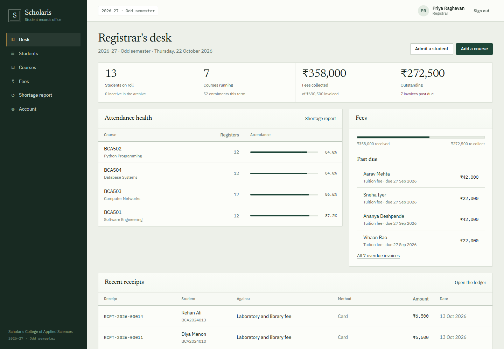
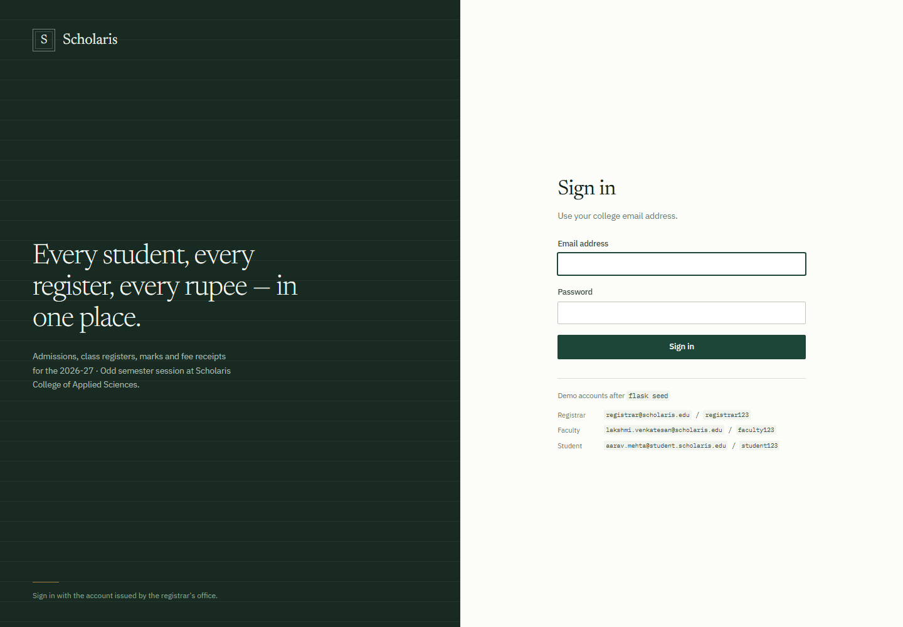
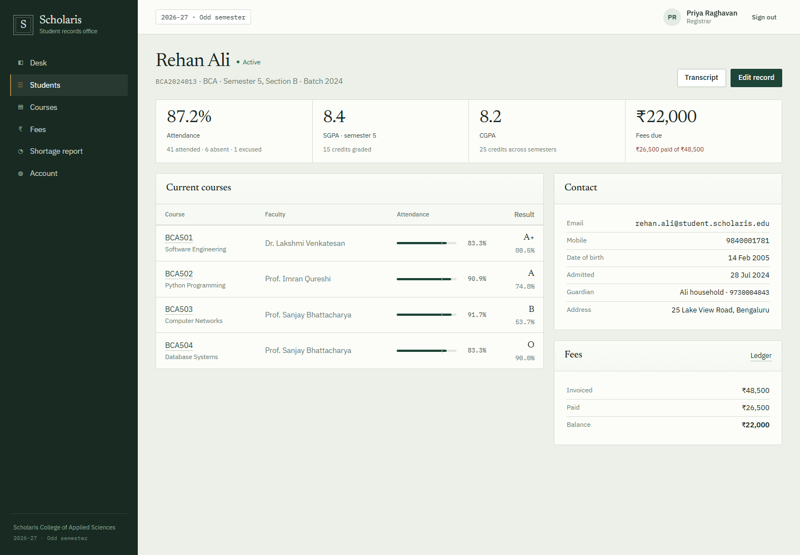
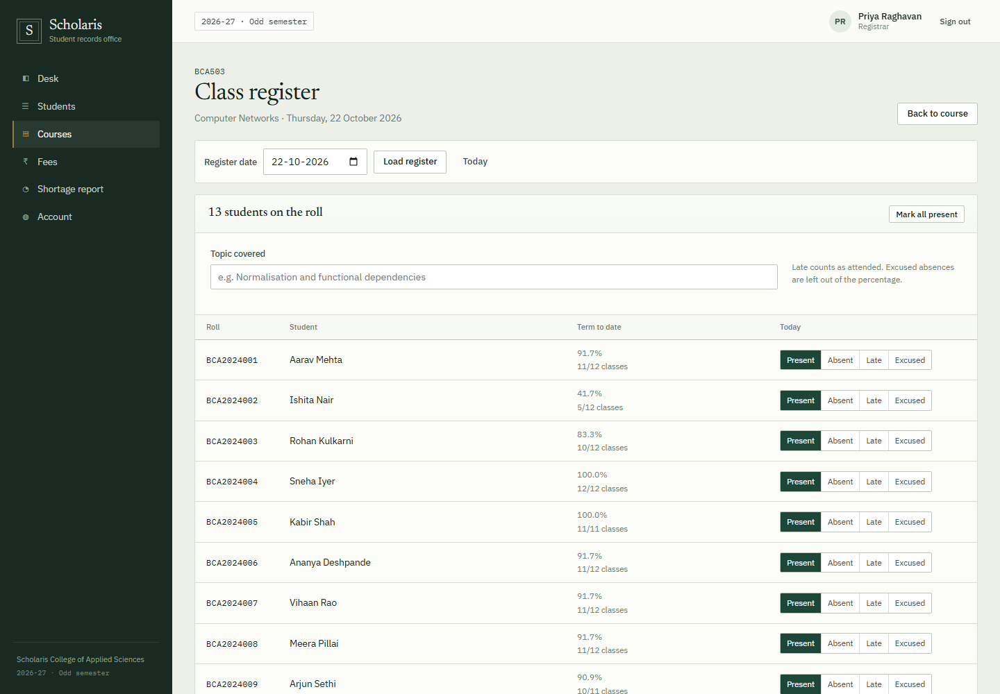
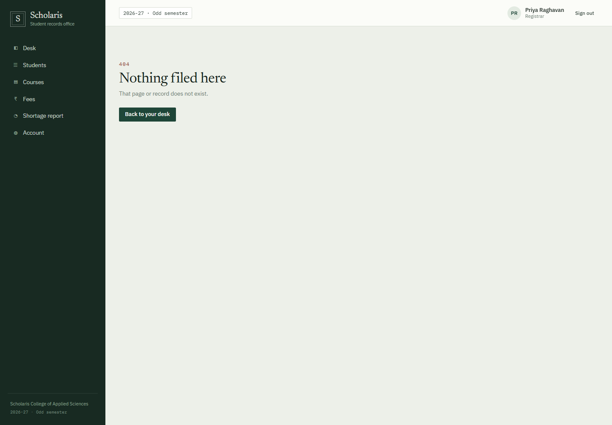
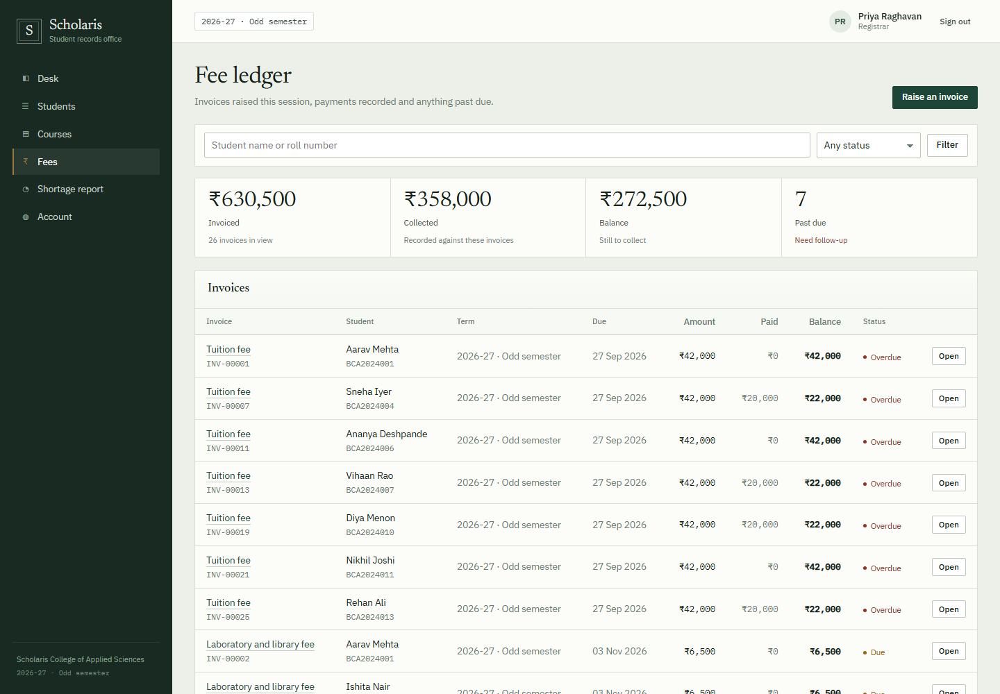
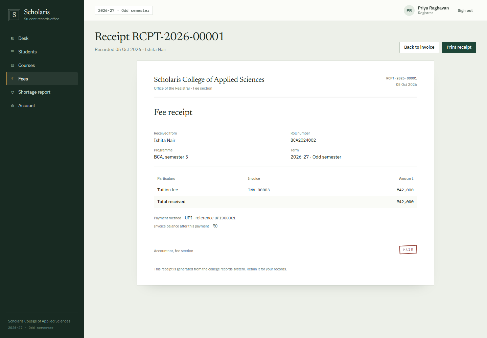

# Scholaris — Student Management System

A student records system for a college registrar's office, built with **Python and Flask**.
It covers admissions, course enrolment, class registers, weighted grades, transcripts and a
fee ledger, with separate views for the registrar, faculty and students.

The interface is styled after the physical artefacts a registrar actually uses — ruled
registers, mark sheets and stamped receipts — rather than a generic admin dashboard.



## What it does

**Registrar (admin)**
- Admit students and create their sign-in accounts in one step
- Search and filter the student register by name, roll number, programme or status
- Maintain the course catalogue, assign faculty and control seat capacity
- Raise fee invoices, record full or part payments and print receipts
- See attendance shortage across the college and export-ready transcripts
- Dashboard: enrolment counts, fee collection, overdue invoices, course attendance health

**Faculty**
- Only see their own courses and students
- Take or update a class register for any date (one register per course per day)
- Enter marks per assessment and see a weighted grade sheet
- Add assessments with custom maximum marks and weights

**Student**
- See attendance per course with a shortage warning at 75%
- See marks, weighted score, current grade, SGPA and CGPA
- Check fee dues and download receipts
- Print a consolidated transcript

## Stack

| Layer | Choice | Why |
| --- | --- | --- |
| Language | Python 3.11 | Required by the brief |
| Framework | Flask 3 + Jinja | Small, readable, easy to explain in a viva |
| Database | SQLite via SQLAlchemy | No server to install; one file, ships with the project |
| Auth | Flask-Login + Werkzeug hashing | Standard session auth with PBKDF2/scrypt hashes |
| Forms | Flask-WTF (CSRF) + server-side validation | Protection without a JavaScript build step |
| Styling | Hand-written CSS | No Node, no build pipeline, fully controllable |
| Fonts | Self-hosted WOFF2 | Newsreader and IBM Plex render the same offline |
| Tests | pytest | Pure calculation tests plus request-level workflow tests |

There is no JavaScript framework and no build step. `app/static/js/app.js` is ~60 lines of
progressive enhancement (nav, confirm dialogs, mark-all-present, print).

## Run it on any Windows PC (no installation)

1. Copy the whole project folder, including the `portable/` folder.
2. Double-click **`START_SCHOLARIS.bat`**.
3. The browser opens at <http://127.0.0.1:5000>. Sign-in details are in
   [LOGINS.txt](LOGINS.txt).

`portable/` is an embedded Python 3.11 with every package already installed, so the
machine needs no Python, no pip and no internet. The launcher also:

- seeds the demo college on first run,
- picks 5001, 5002, ... if port 5000 is busy,
- opens the browser once the server answers,
- prints a readable error and waits instead of closing if anything fails.

If `portable/` is missing (for example after a `git clone`), the same launcher falls back
to a system Python, creates `.venv` and installs `requirements.txt` once. With no Python
at all it explains how to fix it instead of failing silently.

Afterwards, `RESET_DEMO_DATA.bat` rebuilds the sample college from scratch.
The SQLite file lives at `instance/scholaris.db` and is git-ignored.

### Run it as a developer

Requires Python 3.10+.

```bash
python -m venv .venv
.venv\Scripts\activate          # Windows
# source .venv/bin/activate     # macOS / Linux

pip install -r requirements.txt
flask --app run.py seed
flask --app run.py run --debug
```

`flask --app run.py seed --force` rebuilds the demo data. `python launch.py` is the
double-click launcher without the batch file (also works on macOS and Linux).

### Presenting it in college

Read [HOW_IT_WORKS.md](HOW_IT_WORKS.md) for a request-by-request walkthrough, a three-minute
demo script and the questions a panel usually asks.

Run it from the laptop you will demo on, not over the campus Wi-Fi. The site is served by
Python, so there is nothing to upload: `localhost` is private to the machine running it.
If a live link is required, deploy the app (see below) rather than sending HTML files —
the templates need Flask and the database to render.

| File | What it is for |
| --- | --- |
| `START_SCHOLARIS.bat` | Double-click to run the site |
| `LOGINS.txt` | Printable sign-in sheet for every demo account |
| `RESET_DEMO_DATA.bat` | Rebuilds the sample college if the demo data gets messy |
| `portable/` | Embedded Python + packages (not in git; needed on the college PC) |
| `instance/scholaris.db` | The database file, created on first run |

### Demo accounts

| Role | Email | Password |
| --- | --- | --- |
| Registrar | `registrar@scholaris.edu` | `registrar123` |
| Faculty | `lakshmi.venkatesan@scholaris.edu` | `faculty123` |
| Student | `aarav.mehta@student.scholaris.edu` | `student123` |

The seed creates 13 students, 5 faculty, 7 courses across two semesters, 48 class registers,
two semesters of assessment records and 26 fee invoices with a mix of paid, partial and
overdue balances. Every student account uses the password `student123`; the full list is in
[LOGINS.txt](LOGINS.txt).

## Project layout

```
launch.py              starts the app, seeds on first run, opens the browser
START_SCHOLARIS.bat    Windows double-click entry point
RESET_DEMO_DATA.bat    rebuilds the demo college
LOGINS.txt             sign-in sheet for every demo account
portable/              Windows Python runtime used by the launcher (not in git)
app/
  __init__.py          app factory, filters, error pages
  config.py            configuration and DATABASE_URL handling
  extensions.py        db, login manager, CSRF
  models.py            all tables and small domain helpers
  services.py          attendance, GPA, weighting and fee calculations
  security.py          role decorators and course-ownership checks
  helpers.py           request parsing
  cli.py               `flask seed` demo data generator
  blueprints/
    auth.py            sign in/out, password change, login throttling
    dashboard.py       role-specific landing pages
    students.py        register, admission, profile
    courses.py         catalogue, enrolment, registers, marks, grades
    finance.py         invoices, payments, printable receipts
    reports.py         transcript, attendance shortage
  templates/           Jinja templates (one folder per area)
  static/css/app.css   the whole design system
  static/fonts/        self-hosted Newsreader and IBM Plex WOFF2 files
  static/js/app.js     progressive enhancement
tests/
  conftest.py          in-memory database + fixtures
  test_services.py     grade bands, weighting, attendance, fees
  test_auth.py         sign-in and record isolation
  test_workflows.py    admission, registers, marks, payments
  test_pages.py        renders every page for every role
```

## The rules the system encodes

These are the decisions an examiner is most likely to ask about.

**Grading (10-point scale)**

| Percentage | Grade | Points |
| --- | --- | --- |
| 90–100 | O | 10 |
| 80–89.9 | A+ | 9 |
| 70–79.9 | A | 8 |
| 60–69.9 | B+ | 7 |
| 50–59.9 | B | 6 |
| 40–49.9 | C | 5 |
| below 40 | F | 0 |

A course score is the weighted average of its assessments
(`sum(percentage × weight) / sum(weight)`). Weights are normalised, so a course whose
assessments only add up to 80% still produces a comparable percentage. Assessments that have
no marks entered are excluded and the result is flagged incomplete. SGPA is credit-weighted;
CGPA is credit-weighted across every semester with recorded results.

**Attendance**
- One register per course per calendar day; saving the same date again updates it.
- `present + late` counts as attended.
- Excused absences are removed from the denominator, so authorised leave does not penalise
  a student.
- Anything below 75% is flagged and the report shows how many consecutive classes at 100%
  are needed to recover.

**Fees**
- Each invoice has a due date; balance is `amount − sum(payments)`.
- Status precedence: paid → overdue → partial → due, so a part-paid invoice past its due
  date is reported as overdue.
- Payments are refused if they exceed the outstanding balance or are dated in the future.
- Receipt numbers are generated sequentially (`RCPT-2026-00001`) and each payment has its
  own printable receipt.

## Security

- Passwords are hashed with Werkzeug (`generate_password_hash`), never stored or logged.
- CSRF protection on every POST via Flask-WTF; logout is POST-only.
- Role checks are server-side decorators; a teacher can only touch their own courses and a
  student can only read their own profile, fees and transcript. Direct URL access is tested.
- Six failed logins per email/IP within ten minutes are throttled (in-process; a production
  deployment would move this to Redis).
- Next-URL redirects are restricted to relative paths to prevent open redirects.
- Security headers: HttpOnly session cookie, `SameSite=Lax`.

## Tests

```bash
pytest -q
```

36 tests cover grade boundaries, weight normalisation, excused-absence handling, SGPA/CGPA,
invoice state transitions, sign-in, role isolation, register upserts, future-date rejection,
marks validation, payments and receipts. A page smoke test renders every screen for each of
the three roles, so a broken template cannot hide behind a passing unit test.

## Deploying it

**PythonAnywhere (free)** is the recommended host: the app runs on a normal WSGI server and
the SQLite file lives on persistent disk, so nothing in the code changes. The free web app
is switched off after about a month without a login, so renew it before a viva.

**Render + Neon (free)** gives a permanent URL with automatic deploys from GitHub. Render's
free disk is ephemeral, so the database moves to Neon's free Postgres — `DATABASE_URL` is
all it takes. The free instance sleeps after 15 minutes, so the first request can take a
minute.

**Vercel and Cloudflare Workers are not a fit.** Vercel can run Flask as a serverless
function but has no writable disk (it would still need Neon); Cloudflare Workers cannot run
Flask or SQLAlchemy at all. Both would mean a rewrite, not a deployment.

Step-by-step instructions for both working options, including environment variables and
seeding, are in [DEPLOY.md](DEPLOY.md).

## Why the code is organised this way

Four decisions that shaped the structure:

**An app factory plus blueprints.** `create_app()` in `app/__init__.py` builds the
application, registers the six blueprints and creates missing tables at startup. The same
function is used by `flask run`, by `launch.py` and by the tests, which stand up a fresh
in-memory database for every test.

**Calculations live in `services.py`, not in routes.** Grade bands, weighted averages,
SGPA/CGPA, attendance percentages and invoice state are functions that take rows and return
numbers. They can be tested without a browser, and the dashboard, the grade sheet and the
transcript all get the same answer from the same code.

**Permissions are checked on the server, in one place.** `security.py` holds
`role_required` and `require_course_access`. Every route that touches a record calls one of
them. Hiding a link in a template is a convenience; the check that matters is the redirect
or 403 the server returns.

**No JavaScript build step.** The interface is server-rendered Jinja with a single
stylesheet. `app/static/js/app.js` only adds conveniences — the small-screen navigation,
mark-all-present, print buttons — and every form still works with JavaScript disabled.

**One register per course per day** is a deliberate simplification: a unique constraint on
(course, date) means re-saving a date corrects it instead of duplicating it. Recording
each period separately would need a slot column on the session table, which is listed under
limitations rather than half-implemented.

## Limitations and next steps

- No timetable module; courses are not scheduled into periods.
- Attendance is per day, not per period, so two lectures of the same course on one day
  cannot be recorded separately.
- Login throttling is in-process, so it resets on restart and does not work across workers.
- No file uploads (student photographs, documents) or email notifications.
- A production deployment should add migrations (Alembic/Flask-Migrate), a WSGI server and
  structured logging.

## Screenshots

| | |
| --- | --- |
|  |  |
|  |  |
|  |  |
